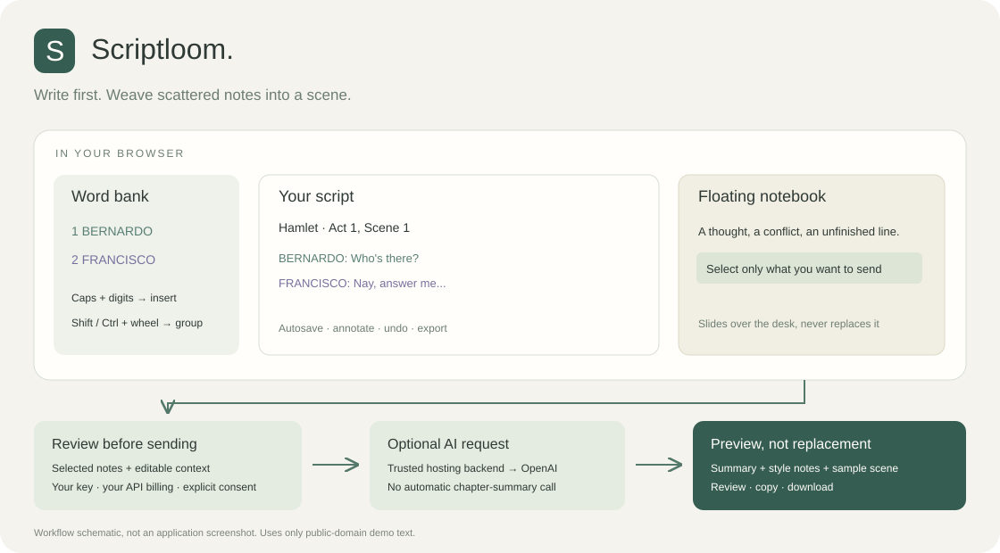

# Scriptloom
### Weave scattered notes into a scene.

[简体中文](README.zh-CN.md) · English

A small, browser-local script desk with colored word banks, a floating notebook, and optional AI-assisted sample scenes. Write first; use AI only when you explicitly ask.

## What it does
- **Write and annotate:** plain-text script editing, independent colored annotations, customizable word groups, undo/redo.
- **Keep words close:** ten slots per group, with Caps Lock + digits in the script and notebook. Shift + wheel changes groups; Settings can change that modifier to Ctrl.
- **Catch a thought:** a sliding notebook above the editor, with a draggable vertical handle and independent undo/redo.
- **Keep your work:** browser-local autosave; JSON workspace backup/restore; TXT import/export; colored reading-only HTML export.
- **Optional AI:** select notes, edit the context and instructions, review the transmission, then request a summary and sample scene using your own OpenAI API key. Results are previews, never automatic replacements.
- **Preferences:** Chinese/English interface, editable model list/default, output limit, and optional passphrase-encrypted local key storage.
- **First-run sample:** a public-domain English opening excerpt from *Hamlet*, with character and stage annotations. Existing saved workspaces are preserved.

This is an early prototype, not a collaborative editor, production credential manager, or automatic full-script summarizer. No cloud document sync or universal AI-provider integration is included.

## Try the editor locally
Use Node.js 22 or newer and npm:

~~~sh
npm ci
npm run dev
~~~

Open **http://127.0.0.1:4173/**. Editing, notebook, settings, import/export and prompt preparation work locally. **The local preview is static: AI generation is not wired to a local backend.** You do not need an API key for ordinary writing or tests.

~~~sh
npm test
npm run typecheck
npm run build
~~~

Browser integration checks: open **http://127.0.0.1:4173/tests/browser.html** while the dev server runs, then click “Run browser checks.” These use isolated fake storage and mocked API responses.

## AI workflow
1. Open the notebook and select the text to process.
2. Click **Selected notes → AI draft**.
3. Review the selected notes; edit the default script context, or switch to separate previous/following context.
4. Choose a model available to your API account, an output limit, and optional writing directions.
5. Supply a temporary key, or unlock your optional locally encrypted key. Confirm the data transmission and API billing.
6. Send; review, copy or download the preview. Closing the dialog clears its preview.

Notes are limited to 12,000 characters; context totals 24,000; additional direction 2,000. The default context is only the first 24,000 script characters, not necessarily the whole script. Output limit: 256–4,000 tokens. Limits use JavaScript string length. There is no automatic chapter summary or hidden second model call. API charges belong to the supplied key's account; cancelling does not refund prior work.

## Deployment
See [deployment notes](docs/DEPLOYMENT.md). The bundled AI endpoint targets a **trusted Sites authentication gateway**. It is **not safe to expose unchanged behind arbitrary hosting**: a client-supplied identity header is not authentication. GitHub Pages can host the editor assets, but cannot run this Worker endpoint.

No live demo link is included: the author's existing deployment remains private.

## Privacy and security
Drafts, notes and preferences are stored in this browser, not in a workspace database. Plain draft storage is **not encrypted**. Export regular JSON backups.

Only explicit AI generation sends selected notes, edited context, directions and your API credential through the hosting backend to OpenAI. The request sets store:false, but this does **not** guarantee zero provider/platform retention. See [security notes](SECURITY.md) before using key storage or deploying.

## Project map
| Path | Purpose |
| --- | --- |
| src/ | Framework-free browser app |
| server/api.mjs | OpenAI Responses API forwarding handler |
| scripts/ | Local static preview and Worker asset bundling |
| tests/ | Unit tests and manual-launch browser harness |
| docs/ | Deployment and design diagram |

## Verification
The preparation build passes 21 unit tests and TypeScript checking. The latest app revision passed 32 Chromium browser checks, including new Hamlet defaults and existing-workspace preservation. Desktop and 390px responsive settings layouts were visually checked. Windows hardware Caps/IME behavior and real iOS/Safari remain manual checks. Tests do not make paid model calls.

## Contributing and license
[MIT](LICENSE), copyright bruho5. See [CONTRIBUTING.md](CONTRIBUTING.md) and [third-party notices](THIRD_PARTY_NOTICES.md).
