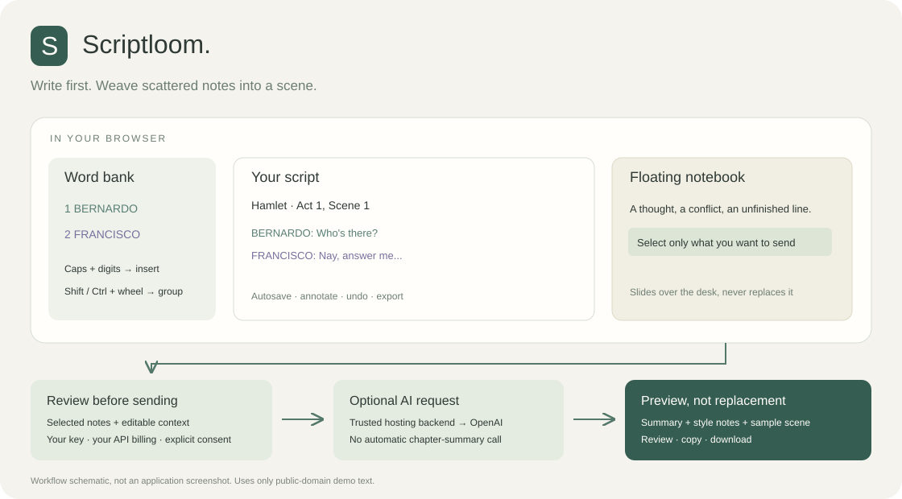

# Scriptloom
### 把零散灵感，织成一场戏。

简体中文 · [English](README.md)

一个轻量的浏览器本地剧本工作台：彩色词库、浮动笔记，以及可选的 AI 样稿辅助。先创作，需要时再主动调用 AI。

## 第一次用？Windows 下载与启动（不用 Git）

**这是源码项目，目前没有 .exe 安装包，也没有公开在线体验站。** 不会 GitHub 也没关系：下载 ZIP、安装一次 Node.js，再运行一条命令即可打开本地编辑器。**本地版可以写剧本，但 AI 生成暂时不能直接使用。**

### 1. 下载并解压
1. 打开 [Scriptloom 仓库首页](https://github.com/bruho5/scriptloom)；如果在 README 文件详情页，先回首页。
2. 点击文件列表上方的绿色 **Code** 按钮 → **Download ZIP**。不需要安装 Git 或登录 GitHub。
3. 下载得到类似 **scriptloom-main.zip** 的文件。在资源管理器里右键它 → **全部解压缩**。
4. 解压到自己想放的位置，例如 **E:\Projects**。打开里面的 **scriptloom-main** 文件夹，确认能同时看到 **package.json、src、scripts**。
   - 如果只看到另一个同名文件夹，再进入一层。
   - 不要直接在压缩包内运行，也不要双击 src/index.html；下面会用本地服务器打开。

### 2. 安装 Node.js（只需一次）
1. 前往 [Node.js 官方下载页](https://nodejs.org/en/download)，选择 Windows 和 **LTS** 版本（本项目要求 22 或更新），下载适合电脑的 **Windows Installer (.msi)** 并安装。
2. 安装后关闭已经打开的命令窗口，再重新打开。普通使用不需要 Git、Python、Visual Studio，也不需要 API Key。

### 3. 在项目文件夹里启动
1. 保持资源管理器打开在第 1 步那个含 **package.json** 的文件夹。
2. 点击资源管理器顶部的地址栏，输入 **cmd**，按回车。这会在正确文件夹打开命令提示符，不用自己输入完整路径。
3. 先输入下面这行并回车，确认显示 v22 或更高版本号：

~~~bat
node --version
~~~

4. 再输入：

~~~bat
node scripts/serve.mjs
~~~

5. 看到 **Local: http://127.0.0.1:4173/** 后，**不要关闭这个命令窗口**。在 Edge、Chrome 等浏览器的地址栏打开：

**http://127.0.0.1:4173/**

这里的地址是你自己的电脑，不是公开网站。日常写作**不需要运行 npm ci，也不需要先 build**；本地服务只用 Node.js 自带模块。只有开发检查才需要下面的 npm 步骤。

### 4. 怎么开始写、保存、退出
- 首次打开是《哈姆雷特》示例。点正文区域就能编辑；右侧「笔记」把手可展开草稿纸。
- 想从空白开始，在「导入 / 导出」中选新建空白稿；按界面确认，原工作区会先备份。
- 草稿自动保存在**当前浏览器的本地存储**，不是写回下载的文件夹，也不会自动同步到别的浏览器或电脑。别在无痕窗口里当成长期存档。
- 重要稿件请用「导入 / 导出」→「完整工作区 .json」定期另存备份，尤其在清理浏览器数据之前。
- 退出时在命令窗口按 **Ctrl + C** 停止服务。下次重复第 3 步启动，再用同一浏览器、同一地址打开；正常情况下会恢复该浏览器保存的稿件。

### AI 按钮为什么不能直接用？
ZIP 内的本地服务器只提供编辑器页面，**没有接通 /api/draft 后端**。因此即使在本地输入 API Key，「AI 样稿」也不能成功生成；不需要为了试用普通编辑功能去申请或付费买 Key。你仍可用「整理提示词 · 复制 / 导出」在本地整理材料，再由自己决定是否粘贴到其他 AI 工具。要接通自动生成，需要另行部署并配置可信认证的后端，见 [部署说明](docs/DEPLOYMENT.md)。

### 常见卡点
- **“node 不是内部或外部命令”**：先完成 Node.js 安装，再关闭并重新打开命令窗口。
- **“Cannot find module ...serve.mjs”**：命令窗口不在正确目录；回到能看见 package.json 和 scripts 的文件夹，用地址栏输入 cmd 重新开。
- **“EADDRINUSE”**：4173 端口已被占用。若之前已经启动 Scriptloom，先尝试浏览器打开上面的地址；不要重复开多个服务。否则关闭你自己之前启动的服务后再试，不要随意结束陌生进程。
- **网页打不开**：确认命令窗口仍在运行，复制完整 http 地址而不是搜索它。
- **换浏览器后稿件不见了**：回到原浏览器导出 JSON，再到新浏览器导入；不要清空原浏览器数据。

## 能做什么
- **写与标记：**纯文本剧本、独立的彩色标记、自定义词组、撤销/重做。
- **把常用词放在手边：**每组十个词位。Caps Lock 开启后，在正文和笔记中用数字插词；Shift + 滚轮切组，可在设置中换为 Ctrl + 滚轮。
- **留住灵感：**覆盖在编辑区上方的抽拉笔记本，可拖动边缘把手调整高度，笔记有独立撤销/重做。
- **保存和带走：**浏览器本地自动保存，JSON 完整工作区备份/恢复，TXT 导入导出，彩色只读 HTML 导出。
- **可选 AI：**选中笔记，编辑上下文与要求，确认后使用自己的 OpenAI API Key 生成总结和样稿。结果仅预览，不自动改正文。
- **基础设置：**中英文界面，自定义模型列表及默认模型、输出上限，可选口令加密保存 Key。
- **首次示例：**《哈姆雷特》第一幕第一场开头的公版英文节选，附人物和舞台标记。已有工作区不会被新示例覆盖。

这是早期原型，不是多人协作编辑器、专业密码管理器或自动全剧本概括工具；不含云端文档同步，也不是通用模型提供商客户端。

## 开发者安装与检查
使用 Node.js 22 或更新版本以及 npm：

~~~sh
npm ci
npm run dev
~~~

打开 **http://127.0.0.1:4173/**。编辑、笔记、设置、导入导出与本地提示词整理可以使用。**本地预览是静态服务，没有接通 AI 后端。**普通写作和测试不需要 API Key。

~~~sh
npm test
npm run typecheck
npm run build
~~~

浏览器检查：保持开发服务器运行，打开 **http://127.0.0.1:4173/tests/browser.html**，点 “Run browser checks”。使用隔离的模拟存储和模拟 API，不会发付费请求。

## AI 怎么用
1. 展开笔记，选中要处理的文字。
2. 点击「选中笔记 → AI 样稿」。
3. 检查笔记，编辑剧本上下文，也可选择「上文 / 下文分开」。
4. 选择自己 API 账户可用的模型、输出上限，补充创作方向。
5. 输入临时 Key，或解锁之前选择加密保存的 Key；确认发送内容与 API 计费。
6. 发送并审阅结果，复制或下载；关闭窗口会清除本次预览。

所选笔记上限 12,000 字符，上下文合计 24,000，额外要求 2,000；默认仅取正文前 24,000 字符，不一定是全剧本。输出上限为 256–4,000 tokens。字符数按 JavaScript 字符串长度计算。没有自动章节概括或隐藏的二次调用。费用由 Key 对应的账户承担，取消等待不会退回已产生费用。

## 部署与隐私
见 [部署说明](docs/DEPLOYMENT.md) 和 [安全说明](SECURITY.md)。

当前 AI Worker 依赖 **Sites 的可信认证网关**。不能直接暴露在任意服务器上并把客户端可伪造的身份请求头当登录认证。GitHub Pages 可以放编辑器静态文件，但不能运行这个 Worker API。

现有作者站点仍为私人站点，本仓库不提供其地址或登录方式。草稿和笔记仅自动保存于本浏览器，但普通草稿存储**没有加密**，请定期导出 JSON。

主动请求 AI 时，选中笔记、编辑过的上下文、要求及 API 凭据会经过站点后端发往 OpenAI。请求设置 store:false，不等于承诺平台或提供商零留存。不要把真实 Key、私人草稿或含账户信息的截图提交到仓库。

## 测试状态
发布准备版通过 21 项单元测试和 TypeScript 检查；最新应用版本通过 32 项 Chromium 浏览器检查，包括新用户示例和旧工作区兼容。桌面及 390px 布局已视觉检查。Windows 实体 Caps/输入法及真实 iOS/Safari 仍需手测。

## 贡献与许可
[MIT 许可证](LICENSE)，版权署名 bruho5。参见 [贡献说明](CONTRIBUTING.md) 和 [第三方来源](THIRD_PARTY_NOTICES.md)。
